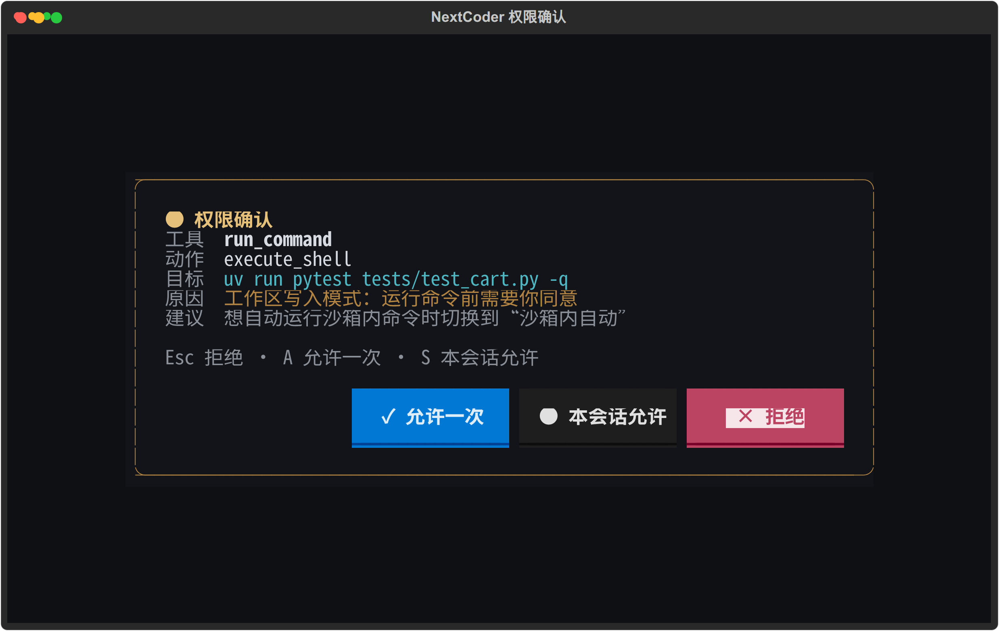

<p align="center">
  
</p>

<h1 align="center">NextCoder</h1>

<p align="center">
  <strong>在现有仓库里读代码、改文件、跑测试，每一轮留下可审查的补丁和报告。</strong>
</p>

<p align="center">
  
  
  
  
</p>

<p align="center">
  
</p>

NextCoder 是一个在终端里工作的编码 agent。你把 `--task-dir` 指向要改的仓库，它读代码、改文件、运行测试；一轮结束后，改动、报告和工具日志都留在 `.nextcoder/` 里。需要确认的动作会停下来问你，已经做完的改动可以逐项检查，也可以直接取走补丁。

## 安装

需要 Python 3.12、`git`、`bash` 和 [uv](https://docs.astral.sh/uv/)。推荐安装 `ripgrep`；没有时 `search` 会自动退回内置扫描。

```bash
git clone https://github.com/POZLOIZ/NextCoder.git
cd NextCoder
uv sync --extra tui
```

## 配置模型

复制环境变量模板，填入入口地址、模型名和密钥：

```bash
cp .env.example .env
```

想同时保留多个 provider，用 `config/models.local.toml`（模板见 `config/models.example.toml`）：

```toml
[[models]]
name = "work"
provider = "deepseek"
base_url = "https://api.deepseek.com"
model = "deepseek-chat"
api_key_env = "DEEPSEEK_API_KEY"
context_window = 210000
max_output_tokens = 4096
```

密钥只写环境变量名，`nextcoder models` 也只显示地址、模型和变量名，不读取明文。

## 启动

```bash
uv run nextcoder doctor
uv run nextcoder tui --task-dir /path/to/your/repo
```

`--task-dir` 是要修改的代码仓库，不是 NextCoder 自己。会话、计划、记忆和日志保存在目标仓库的 `.nextcoder/` 下。

不打开 TUI 也可以直接用：

```bash
# 单轮任务
uv run nextcoder run --task-dir /path/to/repo --request "修复 ..."

# 多轮对话
uv run nextcoder chat --task-dir /path/to/repo

# 不依赖 Textual 的流式对话
uv run nextcoder chat --stream --task-dir /path/to/repo
```

## 权限

默认是「工作区写入」。四档权限的区别只在于哪些动作需要你点头：

| 模式 | 读取 | 修改 | 删除 | 运行命令 |
|------|------|------|------|----------|
| 逐项确认 | 工作区内放行 | 每次询问 | 每次询问 | 每次询问 |
| 工作区写入 | 工作区内放行 | 工作区内放行 | 每次询问 | 每次询问 |
| 沙箱内自动 | 工作区内放行 | 工作区内放行 | 每次询问 | 有真实隔离时放行，否则询问 |
| 完全放行 | 放行 | 放行 | 放行 | 放行（不可逆命令除外） |

调用 MCP 工具和运行命令的规则相同；敏感文件在非完全放行模式下也会询问。`rm -rf /`、`mkfs`、写设备、提权等不可逆命令在所有模式直接拒绝，不会弹询问。`run` 这类非交互入口没有确认界面，需要询问的动作一律按拒绝处理。

<p align="center">
  
</p>

`auto` 只有在命令容器、当前进程位于容器内，或本机 `bwrap` 真实可用时才自动执行；条件不满足就退回询问，不会假装安全。`bypass` 只建议在完全信任的隔离环境里使用。完整规则见 [docs/permissions.md](docs/permissions.md)。

## 一轮结束后

每一轮在 `.nextcoder/sessions/<id>/turns/<turn_id>/` 留下 `report.json`、`final.patch` 和工具日志。`final.patch` 可以直接 `git apply`；`rollout.jsonl` 记录请求、工具调用、权限回答和计划变化，用于查看和调试。进程中断后重新进入同一会话，会先核对已经开始的写入，再补齐缺失的工具结果，不会重复执行已完成的修改。

## 常用命令

```bash
uv run nextcoder doctor                 # 检查配置和运行环境
uv run nextcoder models                 # 列出模型 profile
uv run nextcoder tui --task-dir <repo>  # 打开终端界面
uv run nextcoder chat --task-dir <repo> # 多轮对话
uv run nextcoder run --task-dir <repo> --request "..."  # 单轮任务
```

## 文档

[架构](docs/architecture.md) · [权限、沙箱与 hooks](docs/permissions.md) · [终端界面](docs/tui.md) · [贡献约定](CONTRIBUTING.md)

## 开发

```bash
uv sync --group dev
uv run ruff check
uv run pytest -q
uv build
```

GitHub Actions 会运行同样的 ruff、pytest 和 build。

## 贡献

问题、想法和改动建议请通过 [GitHub Issues](https://github.com/POZLOIZ/NextCoder/issues) 提出。

## 许可证

[UNLICENSED](LICENSE) — All rights reserved. Copyright (c) 2026 POZLOIZ.
