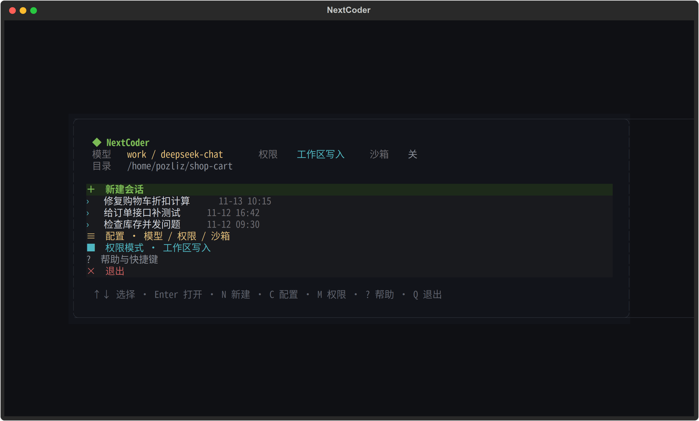
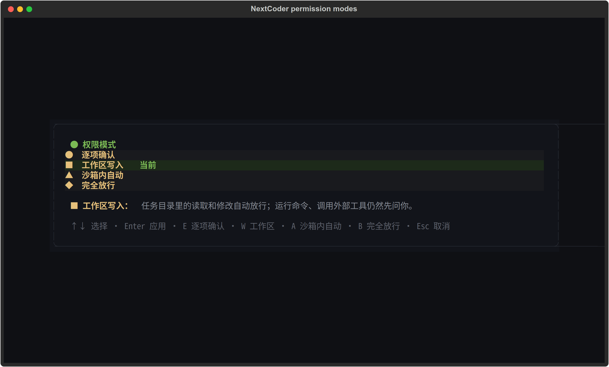

<p align="center">
  
</p>

<h1 align="center">NextCoder</h1>

<p align="center">
  <strong>在现有代码仓库里工作的终端编程助手。</strong><br>
  <sub>A terminal coding agent that works inside your repository.</sub>
</p>

<p align="center">
  
  
  
  
</p>

---

NextCoder 把任务目录当成工作区。它读代码、改文件、运行命令和测试、维护任务清单，并在每一轮结束时留下可以检查的补丁、报告和操作记录。

权限判断、上下文压缩、子 agent、MCP 和崩溃恢复都在同一套运行时里，终端界面负责把过程显示出来。

<p align="center">
  
</p>

<p align="center">
  <sub>启动页：最近会话、当前模型、权限模式和任务目录。</sub>
</p>

## 目录

- [为什么是 NextCoder](#为什么是-nextcoder)
- [快速开始](#快速开始)
- [使用](#使用)
- [配置](#配置)
- [能力](#能力)
- [工作方式](#工作方式)
- [文档](#文档)
- [开发](#开发)
- [贡献](#贡献)
- [许可证](#许可证)

## 为什么是 NextCoder

| 设计目标 | NextCoder 的做法 |
|----------|------------------|
| 在真实仓库里工作 | `--task-dir` 指向目标仓库，文件修改直接落在工作区，结束时导出可 `git apply` 的 `final.patch` |
| 权限可解释 | 逐项确认、工作区写入、沙箱内自动、完全放行四档；命令、文件、MCP 工具走同一套判定 |
| 过程可回看 | 每轮输出 `report.json`、`final.patch`、工具日志和人类可读的 `rollout.jsonl` |
| 中断可恢复 | 检查点加操作审计；重新进入同一会话时核对已开始的写入，补齐缺失的工具结果 |
| 模型可替换 | 任意 OpenAI 兼容端点，通过 `config/models.local.toml` 配置多个 profile |
| 长任务不炸上下文 | 先折叠旧工具正文，超过阈值才生成摘要；摘要不收敛时最多重试一次 |

## 快速开始

需要 Python 3.12、`git`、`bash` 和 [uv](https://docs.astral.sh/uv/)。推荐安装 `rg`；没有时 `search` 会自动退回内置扫描。

```bash
git clone git@github.com:POZLOIZ/NextCoder.git
cd NextCoder
uv sync --extra tui
```

配置模型入口，二选一：

```bash
# 方式一：环境变量 / .env
cp .env.example .env
# 填入 NEXTCODER_LLM_BASE_URL、NEXTCODER_LLM_MODEL、NEXTCODER_LLM_API_KEY
```

```toml
# 方式二：config/models.local.toml（模板见 config/models.example.toml）
[[models]]
name = "primary"
provider = "deepseek"
base_url = "https://api.deepseek.com"
model = "deepseek-chat"
api_key_env = "DEEPSEEK_API_KEY"
context_window = 210000
max_output_tokens = 4096
```

然后启动：

```bash
uv run nextcoder doctor
uv run nextcoder tui --task-dir /path/to/your/repo
```

> [!NOTE]
> `--task-dir` 是要修改的代码仓库，不是 NextCoder 自己。会话、计划、记忆和日志保存在目标仓库的 `.nextcoder/` 下。

不打开 TUI 也可以直接使用：

```bash
# 单轮任务，导出补丁
uv run nextcoder run --task-dir /path/to/repo --request "修复 ..."

# 多轮对话
uv run nextcoder chat --task-dir /path/to/repo

# 无 Textual 的流式对话
uv run nextcoder chat --stream --task-dir /path/to/repo

# 继续已有会话
uv run nextcoder run --task-dir /path/to/repo --session <id> --request "继续 ..."
```

## 使用

启动页提供最近会话、新建、配置、权限模式和帮助。输入 `/` 查看命令补全，输入 `@` 引用任务目录里的文件；助手输出按 Markdown 渲染，每轮有独立的 `ROUND NN` 标题、状态和 token/cache/耗时 footer。

| 按键 | 作用 |
|------|------|
| `Enter` | 发送；补全可见时接受候选 |
| `Shift+Enter` | 换行 |
| `↑` / `↓` | 历史；补全可见时选择候选 |
| `Tab` | 接受 `/` 命令或 `@` 文件候选 |
| `Ctrl-C` | 停止当前轮；空闲时退出 |
| `F1`–`F4` | 帮助 / 配置 / 权限 / 会话 |
| `Ctrl-N` | 新建会话 |

常用斜杠命令：

| 命令 | 作用 |
|------|------|
| `/help` | 查看快捷键和命令 |
| `/new`、`/sessions` | 新建或切换会话 |
| `/config`、`/model`、`/mode`、`/sandbox` | 修改模型、权限模式和执行沙箱 |
| `/plan` | 查看当前任务清单 |
| `/compact` | 手动压缩上下文 |
| `/export` | 导出当前会话补丁 |
| `/clear`、`/status`、`/quit` | 清屏、查看状态、退出 |

缓存显示区分冷启动和暖调用：第一次请求显示「缓存 首次」；总命中率因为冷启动低于 90%、但暖命中率高于 90% 时显示「缓存 75%（暖 94%）」。会话标题取第一条请求的第一行，去掉 Markdown、最长 40 字，不额外调用模型。

## 配置

### 模型 profile

`config/models.local.toml` 用 `[[models]]` 描述任意 OpenAI 兼容入口，密钥只写环境变量名：

```toml
[[models]]
name = "work"
provider = "openrouter"
base_url = "https://openrouter.ai/api/v1"
model = "vendor/model-name"
api_key_env = "OPENROUTER_API_KEY"
thinking = "omit"
context_window = 128000
max_output_tokens = 8192
headers = { "HTTP-Referer" = "https://example.com", "X-Title" = "NextCoder" }

# 可选 429 备援；三元组齐全才启用
fallback_base_url = "https://api.deepseek.com"
fallback_model = "deepseek-chat"
fallback_api_key_env = "DEEPSEEK_FALLBACK_API_KEY"
```

选择顺序：`--profile` 或 `NEXTCODER_MODEL_PROFILE` 显式指定；否则环境已给 `NEXTCODER_LLM_BASE_URL`/`NEXTCODER_LLM_MODEL` 就用环境；否则选 `primary`（没有 primary 选第一条）。`nextcoder models` 只显示地址、模型和密钥变量名，不读取或打印密钥。

### 四档权限

默认「工作区写入」。界面里用日常中文显示，配置文件用英文值：

| 配置值 | 界面名称 | 行为 |
|--------|----------|------|
| `manual` | 逐项确认 | 工作区内读取放行；改文件、删文件、运行命令、调用 MCP 都先问 |
| `workspace` | 工作区写入 | 工作区内读写放行；运行命令、调用 MCP 仍然先问 |
| `auto` | 沙箱内自动 | 工作区内读写放行；命令只在容器或 bwrap 真实可用时自动跑，否则先问 |
| `bypass` | 完全放行 | 除不可逆命令底线外全部放行；只建议在完全信任的隔离环境使用 |

<p align="center">
  
</p>

敏感文件在 `manual`、`workspace`、`auto` 会询问，`bypass` 放行；删除在 `manual`、`workspace`、`auto` 都会询问。`rm -rf /`、`mkfs`、`dd` 写设备、提权、fork 炸弹等不可逆命令在所有模式直接拒绝，而且不会询问。

`auto` 判断「有真实隔离」的依据：配置了 `command_container`、当前进程本身在容器里，或本机 `bwrap` 可用。三条都不满足时会退回询问，不会假装安全。规则文件 `.nextcoder/permissions.json` 支持 `path`、`command_prefix`、`mcp_tool` 三种 scope，`deny` 优先于 `allow`。完整说明见 [docs/permissions.md](docs/permissions.md)。

## 能力

| 能力 | 说明 |
|------|------|
| 文件与命令 | `list_files`、`search`、`read_lines`、`read_log`、`write_file`、`apply_patch`、`run_command`、`view_diff` |
| 任务清单 | `.nextcoder/task-plan.json` 是唯一事实源；TUI 直接读，更新写 rollout |
| 项目记忆 | SQLite 加 Markdown 投影；会话入口注入快照，模型可显式读写，后台整理 agent |
| 子 agent | `researcher`/`reviewer` 只读，`tester`/`coder` 在 git worktree 中写；支持后台、取消、恢复 |
| MCP | stdio 与 Streamable HTTP；工具名 `mcp__server__tool`；密钥只从环境展开 |
| hooks | `before_tool_use` / `after_tool_use`；支持 block、note、reminder，不执行任意脚本 |
| AGENTS.md | 会话创建/加载时读取一次，进入稳定前缀；默认上限 8,000 字符 |
| 多 provider | `config/models.local.toml` 的 profile；任意 OpenAI 兼容端点；可选 429 备援 |
| 崩溃恢复 | 检查点加操作审计；未配对工具调用核对后补齐 |
| 流式 | 首个 chunk 前可切备援；chunk 聚合、tool_calls 合并、reasoning 保留 |

## 工作方式

```
CLI / TUI
   │
   ▼
sessions.manager ──► AgentRunner（LangGraph）
                        ├─ 稳定前缀：基础规则 + AGENTS.md + 记忆快照 + 技能目录
                        ├─ 每轮尾部：任务清单快照 + 最新请求
                        ├─ 上下文：折叠旧工具正文 → 必要时语义摘要
                        ├─ 模型：流式 / 备援 / 超时
                        └─ 工具：hooks → 权限 → 执行 → 审计 → 事件
   │
   ▼
checkpoint / rollout / report / final.patch
```

稳定前缀只在会话开始时组装一次，中途改 `AGENTS.md`、记忆或技能目录，下一会话才生效；任务清单挂在请求尾部，不写检查点。这样既不会破坏服务端前缀缓存，也不会让计划更新改掉整个历史。

会话产物：

```
<repo>/.nextcoder/
├── sessions/<session_id>/
│   ├── session.json
│   ├── rollout.jsonl
│   ├── checkpoints.sqlite
│   ├── operations.sqlite
│   ├── baseline/
│   ├── turns/<turn_id>/{report.json,final.patch,logs/}
│   └── subagents/<child_id>/{report.md,report.json,changes.patch}
├── task-plan.json
├── memory.sqlite
├── memory.md
└── hooks.json / permissions.json / mcp.json
```

`final.patch` 可以直接 `git apply`。`rollout.jsonl` 只用于查看和调试，不参与恢复；恢复看 `checkpoints.sqlite` 和 `operations.sqlite`。更多设计见 [docs/architecture.md](docs/architecture.md)。

## 文档

| 文档 | 内容 |
|------|------|
| [docs/architecture.md](docs/architecture.md) | 运行时结构、一次请求的路径、会话产物 |
| [docs/permissions.md](docs/permissions.md) | 四档权限、规则文件、审批、bubblewrap、hooks |
| [docs/tui.md](docs/tui.md) | 启动页、快捷键、斜杠命令、`@` 文件、缓存与标题 |
| [CONTRIBUTING.md](CONTRIBUTING.md) | 问题反馈和提交改动的约定 |

## 开发

```bash
uv sync --group dev
uv run ruff check
uv run pytest -q
uv build
```

GitHub Actions 会运行同样的 ruff、pytest 和 build。

仓库结构：

```
src/nextcoder/
├── cli.py              # Typer 入口
├── llm.py              # 模型、流式、备援、超时
├── settings.py         # 配置与默认值
├── model_config.py     # 多 provider profile
├── runtime/            # Agent、压缩、权限、hooks、子 agent、MCP、计划、技能
├── sessions/           # 会话、检查点、审计、记忆、恢复、rollout
├── tools/              # 文件、命令、编辑、计划、记忆、技能、MCP
└── tui/                # Textual 界面、弹窗、补全、回合卡片
docs/                   # 设计、权限、TUI
tests/                  # 离线测试与集成测试
```

## 贡献

问题、想法和改动建议请通过 [GitHub Issues](https://github.com/POZLOIZ/NextCoder/issues) 提出。提交 PR 前请先开 issue 对齐范围，并确认 `ruff` 和 `pytest` 通过。更多约定见 [CONTRIBUTING.md](CONTRIBUTING.md)。

## 许可证

[UNLICENSED](LICENSE) — All rights reserved. Copyright (c) 2026 POZLOIZ.
