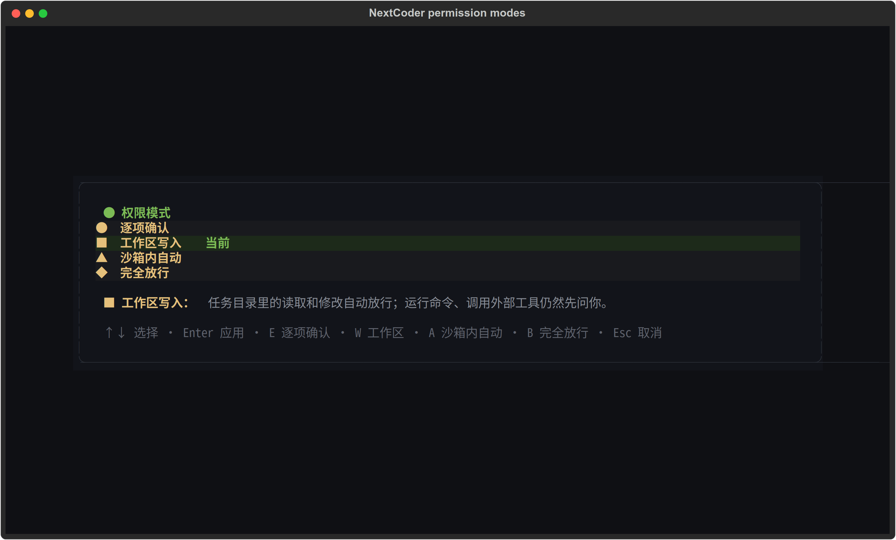

# 权限、沙箱与 hooks

NextCoder 把「要不要做」和「能不能做」分成两层：

- **权限层**决定一个动作是自动放行、先问用户，还是直接拒绝；
- **工具层**始终把文件路径限制在任务目录内，避免模型用 `../` 读写仓库外文件。`bypass` 只放开权限询问，不改变工具层的路径边界。

## 四档权限

默认是「工作区写入」。界面里用日常中文显示，配置文件和环境变量用英文值。

| 配置值 | 界面名称 | 读取 | 修改 | 删除 | 运行命令 | MCP 工具 |
|--------|----------|------|------|------|----------|----------|
| `manual` | 逐项确认 | 工作区内放行 | 每次询问 | 每次询问 | 每次询问 | 每次询问 |
| `workspace` | 工作区写入 | 工作区内放行 | 工作区内放行 | 每次询问 | 每次询问 | 每次询问 |
| `auto` | 沙箱内自动 | 工作区内放行 | 工作区内放行 | 每次询问 | 有真实隔离时放行，否则询问 | 每次询问 |
| `bypass` | 完全放行 | 放行 | 放行 | 放行 | 放行（不可逆底线除外） | 放行 |

补充规则：

- **敏感文件**（`.env`、密钥、凭证等）在 `manual`、`workspace`、`auto` 会询问，不会自动读写；`bypass` 放行。
- **删除**在 `manual`、`workspace`、`auto` 都会询问；`bypass` 才自动放行。
- **不可逆命令底线**在所有模式都直接拒绝，而且不会弹出询问：`rm -rf /`、`mkfs`、`dd` 写设备、提权、fork 炸弹等。
- **非交互入口**（`nextcoder run`、脚本调用）没有询问界面，需要询问的动作一律按拒绝处理。`chat` 和 `tui` 才会弹出「允许一次 / 本会话允许 / 拒绝」。
- 旧配置里的 `standard` 自动迁移为 `workspace`，`aggressive` 自动迁移为 `bypass`。

`auto` 判断「有真实隔离」的依据，满足任意一条即可：

1. 配置了 `command_container`，命令会进入指定容器执行；
2. 当前进程本身就在容器里（检测 `/.dockerenv` 或 `/run/.containerenv`）；
3. 本机 `bwrap` 可用，并且 `bwrap_status()` 返回 `ok`。

三条都不满足时，`auto` 不会假装安全，会退回询问。



## 规则文件

任务目录下的 `.nextcoder/permissions.json` 可以写更细的规则：

```json
{
  "allow": [
    {"scope": "command_prefix", "pattern": "uv run pytest"},
    {"scope": "path", "pattern": "src/*"},
    {"scope": "mcp_tool", "pattern": "github:list_*"}
  ],
  "deny": [
    {"scope": "path", "pattern": "docs/generated/*"}
  ]
}
```

判定顺序是：不可逆命令底线 → `deny` 规则 → `allow` 规则 → 模式默认策略。`deny` 永远优先于 `allow`。`scope` 只支持三种：

- `path`：文件读写删目标，按任务目录内相对路径匹配；
- `command_prefix`：命令字符串前缀匹配；
- `mcp_tool`：`<server>:<tool>` 形式匹配。

## 审批流程

`chat` / `tui` 收到需要询问的动作时：

1. 界面弹出权限请求，显示动作、目标和原因；
2. 选择「允许一次」只放行这一次；「本会话允许」把 `(动作, 目标)` 放进当前会话内存，不写磁盘；
3. 选「拒绝」、按 Esc 或直接退出，都按拒绝处理；
4. 请求和回答都会写 `rollout.jsonl`，便于回看。

## bubblewrap 沙箱

`NEXTCODER_COMMAND_SANDBOX=true` 时，宿主机命令会包一层 `bwrap`。默认策略：

- `--clearenv`，只注入 `PATH`、`HOME`、`TMPDIR`、`LANG` 和白名单变量；
- 不绑定真实 `$HOME`；任务目录是唯一默认可写位置；
- `--unshare-net` 默认断网，需要联网时显式设 `NEXTCODER_COMMAND_SANDBOX_NETWORK=true`；
- `--new-session`、`--die-with-parent`、独立的 PID/IPC 命名空间；
- `sandbox_readonly_roots` / `sandbox_writable_roots` 可以追加挂载目录。

`command_sandbox=True` 时默认 **fail-closed**：找不到 `bwrap` 就拒绝执行并返回明确错误，不会悄悄裸跑。只有显式设 `NEXTCODER_COMMAND_SANDBOX_FAIL_CLOSED=false` 才允许裸跑，并在结果里标注「未沙箱化」。

容器内运行（`command_container` 或进程本身在容器里）不再重复套 bwrap；Docker 已经提供隔离边界。

## hooks

工具执行有两个固定检查点：

| 事件 | 时机 | 能做什么 |
|------|------|----------|
| `before_tool_use` | 权限判定和副作用之前 | 阻止调用、替换参数、追加 note、排队 reminder |
| `after_tool_use` | 执行之后（包括拒绝、阻止、异常） | 追加 note、排队 reminder；不能撤销副作用 |

reminder 不直接改检查点历史，而是在下一次模型请求前由 `HookBus.collect_reminders()` 一次性注入。内置的重复调用提醒、搜索预算提醒、连续空输出提醒也走同一总线；成功编辑文件后，搜索计数由 after hook 复位。

配置放在任务目录 `.nextcoder/hooks.json`：

```json
{
  "hooks": [
    {
      "name": "no-push",
      "event": "before_tool_use",
      "tool": "run_command",
      "pattern": "\\bgit\\s+push\\b",
      "action": "block",
      "reason": "提交只保留在本地，不允许 push。"
    },
    {
      "name": "record-tests",
      "event": "after_tool_use",
      "tool": "run_command",
      "pattern": "pytest",
      "action": "reminder",
      "text": "在最终总结中记录这次测试命令与结果。"
    }
  ]
}
```

`action` 取 `block`（仅 before）、`note`、`reminder`；`tool` 可以是字符串或数组；`pattern` 是正则，匹配工具参数，after 也匹配结果正文；`priority` 越小越先执行。配置不执行任意脚本。`nextcoder hooks --task-dir <repo>` 会校验并列出配置，字段或正则错误直接退出 2。

单个 hook 运行异常只记入 `report.json` 的 `hooks.errors`，不中断工具；hook 触发会发事件并写 `rollout.jsonl`。
