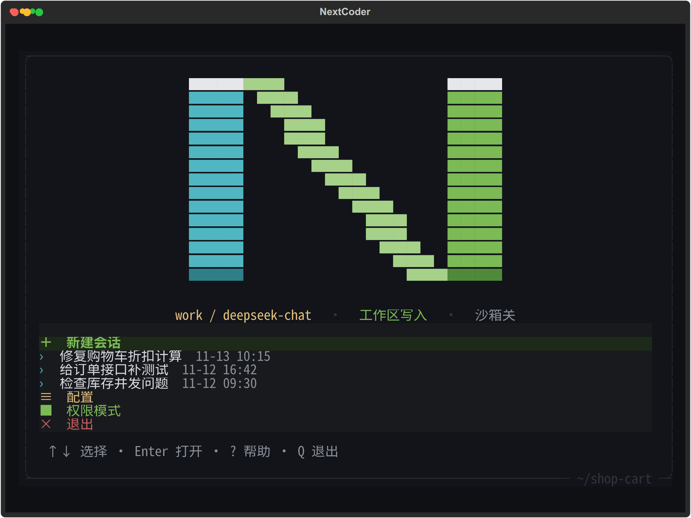

# 终端界面（TUI）

TUI 基于 Textual，启动页、会话、配置、权限和帮助都是真实界面，不是静态演示。它需要可选依赖：

```bash
uv sync --extra tui
uv run nextcoder tui --task-dir /path/to/repo
```

`--task-dir` 是你要修改的代码仓库，不是 NextCoder 自己的目录。任务目录里的 `.nextcoder/` 保存会话、计划、记忆和日志。



## 启动页

启动页只保留日常需要的入口：

- **新建会话**：创建一次新的运行，后台复制基线，界面不会卡住；
- **最近会话**：显示根据第一条请求生成的标题和时间，最多三条，空会话不占位置；
- **配置**：模型 profile、endpoint、模型名、reasoning effort、权限模式、沙箱开关；
- **权限模式**：四档权限，当前档位会高亮并显示说明；
- **退出**。

字标用色块拼出 N，窗口足够大时显示完整像素字标，宽度不足时退回单行 `>_ NextCoder`。字标下方一行显示当前 profile / 模型、权限模式和沙箱状态；任务目录显示在弹窗右下角的边框上。帮助仍然可以按 `?` 或 `F1` 打开。

## 快捷键

| 按键 | 作用 |
|------|------|
| `Enter` | 发送；补全可见时接受候选 |
| `Shift+Enter` | 换行 |
| `↑` / `↓` | 浏览历史；补全可见时选择候选 |
| `Tab` | 接受 `/` 命令或 `@` 文件候选 |
| `Esc` | 关闭补全或弹窗 |
| `Ctrl-C` | 停止当前轮；空闲时退出 |
| `Ctrl-Q` | 退出 |
| `F1` / `F2` / `F3` / `F4` | 帮助 / 配置 / 权限模式 / 会话 |
| `Ctrl-N` | 新建会话 |
| `N` / `C` / `M` / `?` / `Q` | 启动页的新建 / 配置 / 权限 / 帮助 / 退出 |

## 斜杠命令

输入 `/` 会显示补全，按 `Tab` 或 `Enter` 接受。

| 命令 | 作用 |
|------|------|
| `/help` | 帮助、快捷键与命令说明 |
| `/new` | 新建会话 |
| `/sessions` | 切换最近的会话 |
| `/config` | 配置 endpoint、模型、effort、权限与沙箱 |
| `/model` | 切换模型 profile / endpoint |
| `/mode [manual\|workspace\|auto\|bypass]` | 切换权限模式 |
| `/sandbox [on\|off\|network on\|off\|strict on\|off\|status]` | 查看或切换 bubblewrap 沙箱；`strict` 控制 fail-closed |
| `/plan` | 显示或隐藏任务清单面板 |
| `/compact` | 压缩当前会话上下文 |
| `/export [path]` | 把当前对话导出为 Markdown；省略路径时写入 `.nextcoder/exports/`，路径不能超出任务目录 |
| `/clear` | 清空屏幕（不删除会话记录） |
| `/status` | 显示当前会话、模型与运行状态 |
| `/quit` | 退出 |

## `@` 文件引用

输入 `@` 后，界面会索引任务目录内的文件并显示候选：

- 跳过 `.git`、`.venv`、`node_modules`、缓存目录等；
- 浅层文件优先，同层目录排在文件前；
- 插入的 `@path` 是给模型的引用提示，模型仍会用 `read_lines` 真正读取；
- 只索引任务目录，不会把仓库外文件带进来。

## 一轮对话

- 助手输出用 Markdown 渲染；代码块、列表、表格都能显示。
- 每轮有独立的 `ROUND NN` 标题、状态、模型/权限标记和 footer。
- 工具调用显示名称、参数摘要、状态、耗时和完整日志路径；展开/折叠由界面控制。
- 任务清单面板直接读 `.nextcoder/task-plan.json`，按 revision 去重刷新。
- 运行中会显示「正在创建会话…」「模型生成中…」「执行工具：…」「工具完成：…」「压缩中，请稍候」以及子 agent 状态；需要确认的动作会单独弹窗。

### 缓存显示

第一次请求没有前缀可命中，footer 显示「缓存 首次」。同一轮后续调用接近全命中时显示总命中率；总命中率因为第一次冷启动低于 90%、但暖命中率高于 90% 时，footer 显示「缓存 75%（暖 94%）」，状态栏显示带「暖」标记的暖命中率。这样不会把一次冷启动误读成缓存失效。

### 会话标题

标题取第一条用户请求的第一行，去掉 Markdown 前缀，优先在第一句结束处截断，最长 40 字，超出加省略号。标题不调用模型，不进入请求，只用于启动页、状态栏和会话列表。

### 停止与恢复

第一次 `Ctrl-C` 取消当前命令并让模型收尾；第二次直接中止。进程崩溃后重新进入同一会话，会先核对已开始的文件操作并补齐缺失的工具结果，不会重复执行已经完成的写入。

## 配置页

配置页可以改：

- **模型 profile**：来自 `config/models.local.toml` 的 `[[models]]`；
- **endpoint / 模型名**：临时覆盖当前 profile；
- **reasoning effort**：`disabled` / `enabled` / `omit`；
- **权限模式**：四档权限；
- **沙箱开关**：开启后使用 bubblewrap，状态来自真实探测，不是只显示「已开启」。

保存后会写回当前运行配置；模型密钥仍然只从环境变量或 `.env` 读取，界面不会显示明文。

## 常见问题

**启动后黑屏 / 没有界面**

先在真实终端里运行，不要用没有 TTY 的管道或 0×0 窗口。容器里运行时确认 `stdin`/`stdout` 是 TTY。

**提示模型配置错误**

至少需要 `NEXTCODER_LLM_BASE_URL`、`NEXTCODER_LLM_MODEL`、`NEXTCODER_LLM_API_KEY`，或者 `config/models.local.toml` 里一个可用的 profile。`nextcoder models` 只显示地址、模型和密钥变量名，可以用来检查配置。

**沙箱显示不可用**

本机没有 `bwrap`，或命名空间被宿主限制。`command_sandbox=True` 时默认 fail-closed，命令会被拒绝并给出原因；装好 bwrap 或在容器内运行即可。`auto` 模式下没有真实隔离会退回询问，不会假装安全。

**缓存一直是「首次」**

只有一次模型调用时就是冷启动，属于正常现象。继续几轮后仍不出现暖命中率，再检查 endpoint 是否支持前缀缓存。
